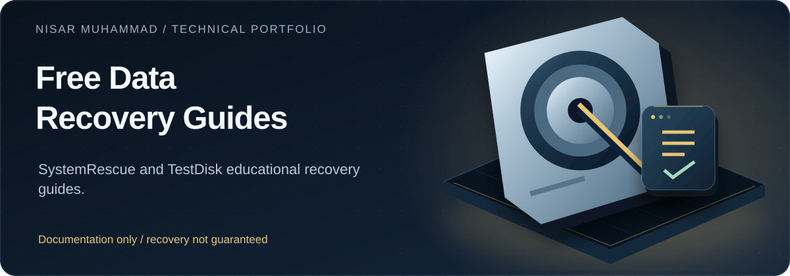

<picture>
  <source media="(max-width: 640px)" srcset="assets/phase2/hero-mobile.svg" />
  
</picture>

# Free Data Recovery Guides

Two free educational guides by Nisar Muhammad for inspecting storage and recovering files after an accidental partition deletion.

> [!IMPORTANT]
> **Stop using the affected drive.** Before creating a boot USB or attempting recovery, verify which disk is the source and where recovered files will go. Read [Safety, user responsibilities and liability](#safety-user-responsibilities-and-liability) first.

1. [SystemRescue Linux beginner guide (PDF)](docs/Free_Data_Recovery_Beginners_Guide.pdf) walks through booting a rescue USB, identifying disks and partitions, and safely inspecting files.
2. [Recover files from a deleted partition (PDF)](docs/Free_Data_Recovery_Step_by_Step_Guide.pdf) shows how to find a lost partition with SystemRescue and TestDisk, preview its files, and copy them to a separate physical drive.

##  Official downloads

- [SystemRescue](https://www.system-rescue.org/Download/)
- [Rufus](https://rufus.ie/)
- [TestDisk](https://www.cgsecurity.org/wiki/TestDisk_Download)

These guides were independently prepared by Nisar Muhammad. The linked tools are developed and distributed by their respective projects. This repository contains documentation only.

##  Before you start

Stop using the affected drive. Verify the source, boot USB, and destination by model and size, and check serial numbers when disks look alike. Creating the boot USB erases the selected USB. Keep logs and recovered files on a separate physical drive.

New writes can overwrite recoverable data. SSD TRIM may make recovery impossible, and encrypted volumes can require the original recovery key. If a drive clicks, disconnects, or reports repeated read errors, stop scanning. For irreplaceable data, seek professional help or work from a verified disk image when one can be safely obtained.

See the [educational-use disclaimer](DISCLAIMER.md).

## Safety, user responsibilities and liability

- Recovery is not guaranteed. Stop using the affected storage and avoid writes to it. Save logs and recovered files to a separate physical drive.
- Confirm the source disk, the destination disk, and the boot USB before proceeding. Writing to the wrong disk can permanently destroy recoverable data. Creating bootable media erases the selected USB.
- If the drive shows signs of failure, stop scanning. Consider a professional recovery service, especially for irreplaceable data.
- Use these educational guides only on storage you own or are authorized to access. You are responsible for disk selection, backups where feasible, and protecting recovered data.

The guides are provided as is, without warranties to the extent permitted by applicable law. The author makes no guarantee of successful recovery and is not liable for damage or loss arising from use to the extent permitted by applicable law. See the [educational-use disclaimer](DISCLAIMER.md).
